<p align="center">
  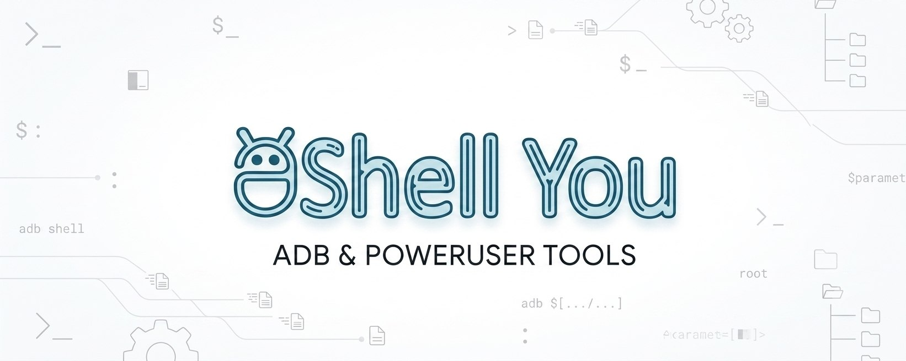
</p>

> **aShell You** is a fully-featured Android shell utility app with **Material Design 3 UI**, letting you run **ADB**, **root** and **shell** commands on your device or others via OTG/wireless, packed in a beautiful and smart interface

</br>

<p align="center">
<a href="https://github.com/DP-Hridayan/aShellYou/stargazers">
    
  </a>
  <a href="https://github.com/DP-Hridayan/aShellYou/forks">
    
  </a>
  <a href="https://github.com/DP-Hridayan/aShellYou/issues">
    
  </a>
  <a href="https://github.com/DP-Hridayan/aShellYou/releases/latest">
    
  </a>
    <a href="https://shields.rbtlog.dev/in.hridayan.ashell">
    
  </a>
  <a href="https://github.com/DP-Hridayan/aShellYou/releases">
    
  </a>
  <a href="https://github.com/DP-Hridayan/aShellYou/graphs/contributors">
    
  </a>
  <a href="https://github.com/DP-Hridayan/aShellYou/blob/main/LICENSE">
    
  </a>
</p>

<p align="center">
    
   
  
      
  
  
  
  
  <a href="https://crowdin.com/project/ashellyou">
    
</a>
</p>

</br>

<h2 align="center">Screenshots</h2>

<div align="center">
  <table>
    <tr>
      <td align="center" width="33%">
        <b>Home Dashboard</b><br/><br/>
        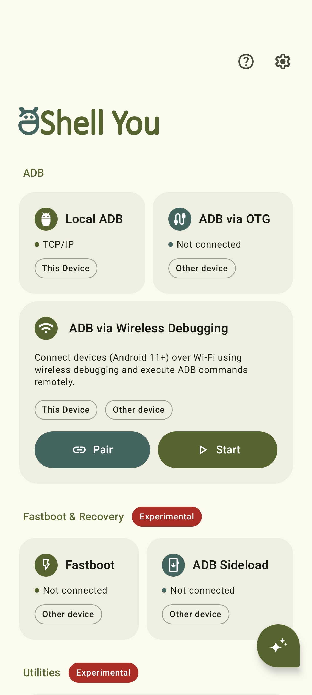
      </td>
      <td align="center" width="33%">
        <b>Local ADB Shell</b><br/><br/>
        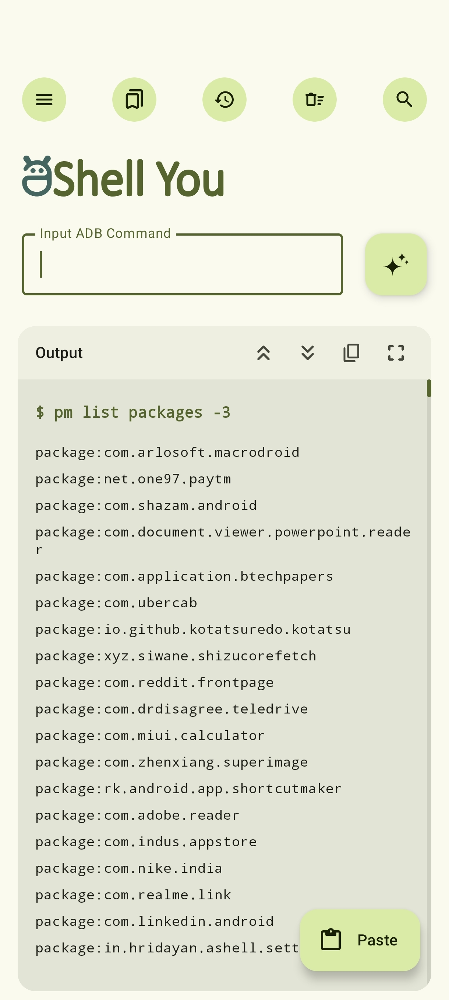
      </td>
      <td align="center" width="33%">
        <b>Wireless Debugging</b><br/><br/>
        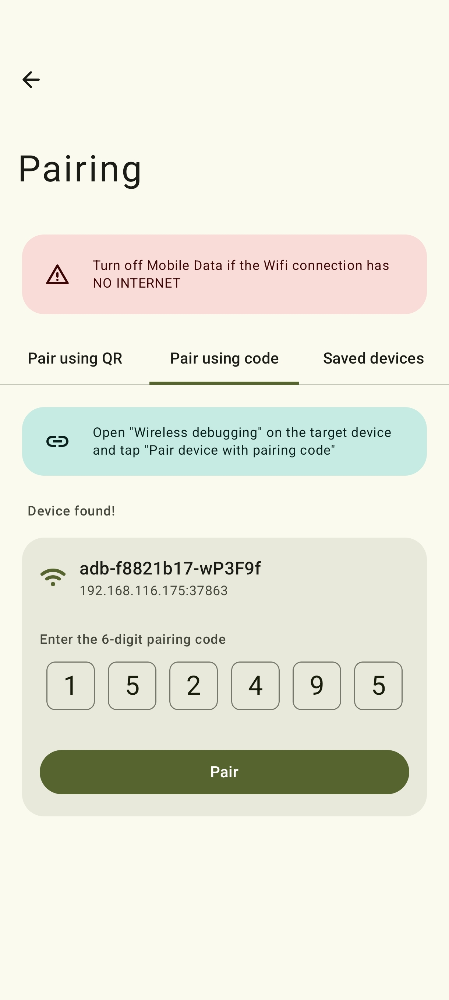
      </td>
    </tr>
    <tr>
      <td align="center" width="33%">
        <b>Screen Mirroring</b><br/><br/>
        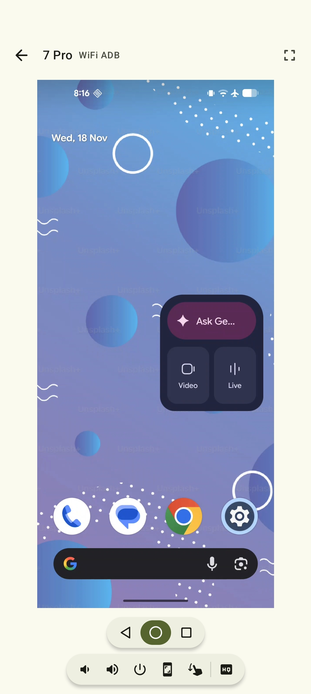
      </td>
      <td align="center" width="33%">
        <b>Fastboot OTG</b><br/><br/>
        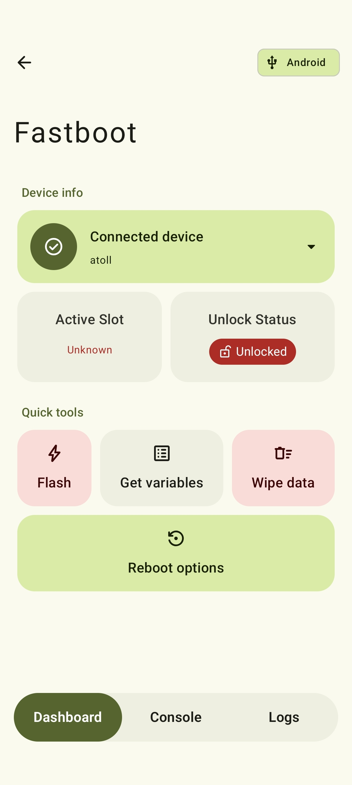
      </td>
      <td align="center" width="33%">
        <b>Logcat viewer</b><br/><br/>
        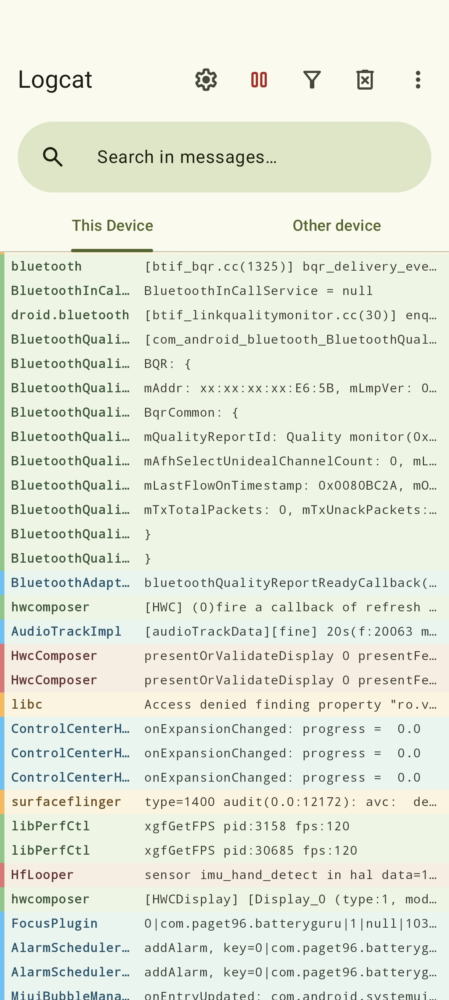
      </td>
    </tr>
    <tr>
      <td align="center" width="33%">
        <b>Remote File Browser</b><br/><br/>
        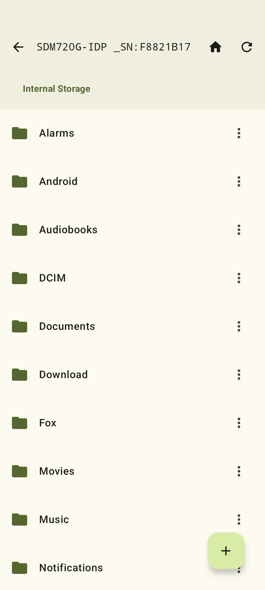
      </td>
      <td align="center" width="33%">
        <b>Port Forwarding</b><br/><br/>
        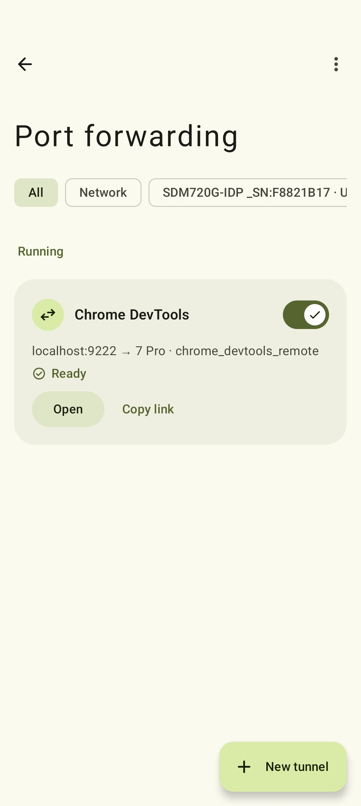
      </td>
      <td align="center" width="33%">
        <b>Command Templates</b><br/><br/>
        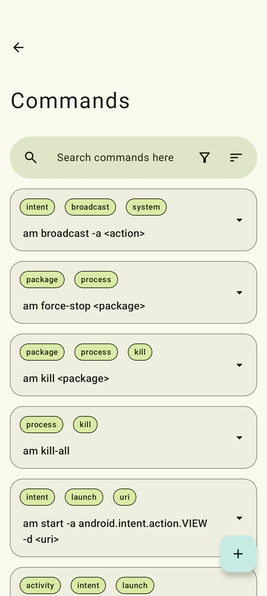
      </td>
    </tr>
    <tr>
      <td align="center" width="33%">
        <b>Quick Settings Tiles</b><br/><br/>
        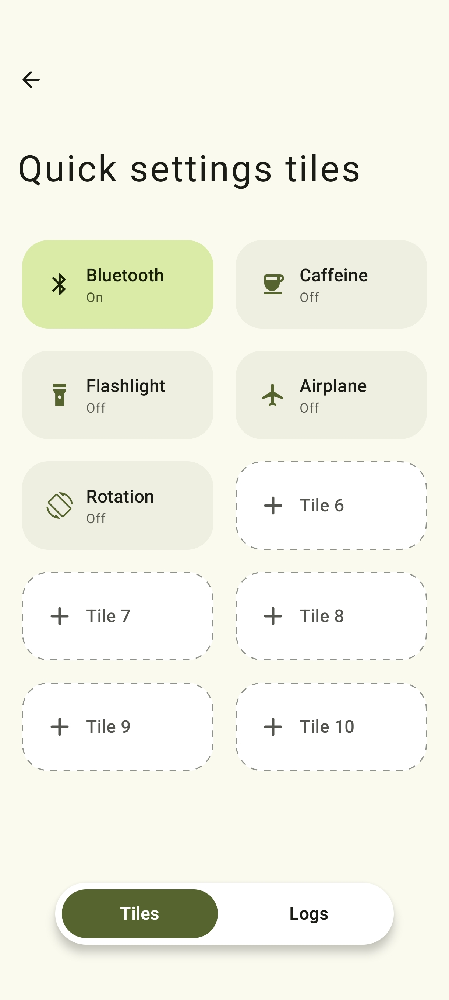
      </td>
      <td align="center" width="33%">
        <b>AI Shell Assistant</b><br/><br/>
        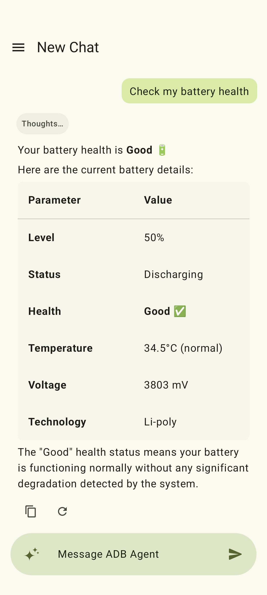
      </td>
      <td align="center" width="33%">
        <b>Settings & Theming</b><br/><br/>
        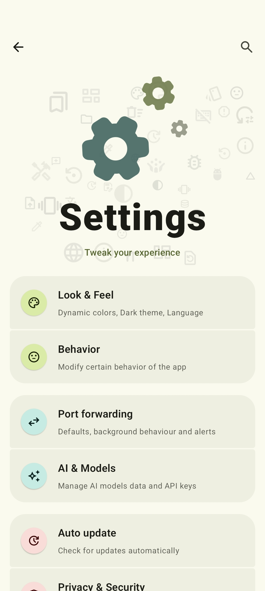
      </td>
    </tr>
  </table>
</div>

</br>

## Features

**Multi-Target Command Execution**
> Execute commands locally using Shizuku (non-root) or root access, wirelessly over Wi-Fi via pairing code or QR code, or through USB OTG cable to control other Android devices without a PC.
</br>

**Fastboot OTG Manager**
> Connect to target devices in bootloader or fastbootd mode over USB OTG to flash partitions (`boot`, `recovery`, `system`, etc.), switch active slots (`a`/`b`), and execute reboot operations directly from your phone.
</br>

**Low-Latency Screen Mirroring**
> Stream and interact with connected Android devices in real time using embedded scrcpy protocols with full touch injection, volume controls, and power navigation pills.
</br>

**Real-Time Logcat Viewer**
> Stream and inspect device log buffers with regex tag search, severity level filters (`Warn+`), color-coded priority markers, and detailed log entry bottom sheets.
</br>

**ADB Sideload**
> Flash and install recovery update packages (`.zip`) over USB OTG with live progress verification and transfer rate metrics.
</br>

**TCP/IP Port Forwarding**
> Configure local and remote port forwarding tunnels (`adb forward` / `adb reverse`) with live connection monitoring and throughput statistics.
</br>

**Remote File Browser**
> Browse, push, pull, move, and delete files on connected ADB targets with path breadcrumb navigation, permission inspection, and conflict resolution.
</br>

**Preloaded Command Examples Catalog**
> Access an organized collection of common Android shell commands with category tags, custom bookmarking, and one-tap execution.
</br>

**Quick Settings Tiles**
> Create customizable system notification tiles to run custom shell scripts or toggle wireless debugging directly from the Android Quick Settings shade.
</br>

**AI Shell Assistant**
> Generate and explain shell commands using integrated AI models with strict explicit confirmation prompts (`Deny`, `Allow`, `Always Allow`) before execution.
</br>

**Continuous Commands & Output Utilities**
> Stream continuous shell operations like `top` or `watch`, perform in-output text and regex searches, export terminal logs to text files, and share output to external apps.
</br>

**Material Design 3 & Personalization**
> Clean Material Design 3 Expressive interface supporting dynamic color schemes, customizable theme palettes, and battery-friendly AMOLED dark mode.
</br>


>[!CAUTION]
>
> Using **aShell You** requires basic knowledge of `ADB/Linux commands`.
>**aShell You** is **not responsible** for any harm caused to your device by improper use of ADB commands

<br/>

>[!TIP]
>
> Please visit our **[Wiki](https://github.com/DP-Hridayan/aShellYou/wiki)** for instructions/setup-guides

</br>

## Download & Community

[](https://github.com/DP-Hridayan/aShellYou/releases/download/v8.0.0/aShellYou-v8.0.0-github-release.apk)
[](https://github.com/DP-Hridayan/aShellYou/releases/latest/)
[](https://f-droid.org/en/packages/in.hridayan.ashell)
[](https://apt.izzysoft.de/fdroid/index/apk/in.hridayan.ashell)

[](https://t.me/aShellYou)
[](https://www.buymeacoffee.com/Hridayan)

## Translations

<p align="start">
  <picture>
    <source media="(prefers-color-scheme: dark)" srcset="docs/translations-dark.svg?ts=1795029154">
    <source media="(prefers-color-scheme: light)" srcset="docs/translations-light.svg?ts=1795029154">
    
  </picture>
</p>

>[!NOTE]
>
> Help us make this project accessible to more people by contributing translations on **[Crowdin](https://crowdin.com/project/ashellyou)**
>
> Thanks to our Crowdin [translators](docs/translators.md)

</br>

<br/>

## Star History

<picture>
  <source media="(prefers-color-scheme: dark)"
    srcset="https://star-chart-xi.vercel.app/api/stars?repo=DP-Hridayan/aShellYou&theme=dark&v=4">
  
</picture>

<br/>

## License

```
Designed and developed by DP Hridayan @2024
This project is licensed under the GNU General Public License v3.0
```
>[!NOTE]
>
>Full license copy [here](LICENSE.md)

</br>

## Privacy Policy

>
>Privacy Policy [here](PRIVACY_POLICY.md)

</br>

# Terms of Service

>
>Terms of Service [here](TERMS_OF_SERVICE.md)

</br>

## Contributors
<a href="https://github.com/dp-hridayan/ashellyou/graphs/contributors">
  
</a>
</br>
